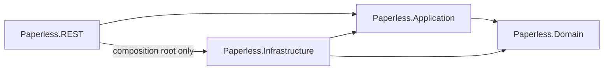

# PaperlessDMS
A Document management system for archiving documents in a FileStore, with automatic OCR (queue for OC-recognition), automatic summary generation (using Gen-AI), tagging and full text search (ElasticSearch).

The current backend implementation plan and rating-matrix review are maintained in
[the backend roadmap](docs/backend-roadmap.md).

## Backend architecture

The backend follows Clean Architecture with compile-time dependencies directed toward the application core:

| Project | Responsibilities | Project dependencies |
| --- | --- | --- |
| `Paperless.Domain` | Framework-independent document and category entities | None |
| `Paperless.Application` | Document/category use cases, application validation, mapping, DTOs and repository contracts | Domain |
| `Paperless.Infrastructure` | EF Core/PostgreSQL, repositories, MinIO, file cleanup and operator commands | Application, Domain |
| `Paperless.REST` | HTTP controllers, request validation, Swagger, exception translation and dependency wiring | Application, Infrastructure |



`Program.cs` is the composition root: it registers application services and infrastructure implementations.
Controllers depend on `IDocumentService` or `ICategoryService`; they do not access repositories or EF Core.
Infrastructure implements repository interfaces declared by Application. Domain has no NuGet dependencies.
Application uses Mapperly only at build time; neither project depends on ASP.NET Core or EF Core.
Splitting the code into projects does not add extra runtime services;
the backend still runs as one REST process.

### Response mapping

Application uses Mapperly 4.3.1 to generate the document, category and file response mappings.
The stateless `ResponseMapper` belongs to Application and is called by its services.
It preserves nullable category names and derives `HasFile` from the metadata flag, storage key or legacy original bytes.
Metadata responses contain no file bytes; downloads retain their existing content.

Mapperly is a private build-time dependency excluded from runtime assets. The generated code is compiled
into Application, so no Mapperly assembly or DI registration is needed at runtime.
See [the mapping guide](docs/mapping.md) for the rules, verification and integration with the migration PR.

### Request and upload flow

1. REST binds and validates HTTP input. `CreateCategoryDto` and `UpdateCategoryDto` remain HTTP request types.
2. The controller converts `IFormFile` to a framework-independent `DocumentUpload` containing file metadata and a stream.
   The controller owns and disposes that stream after the application service completes.
3. Application validates input, reads uploads with a bounded 25 MiB limit, stores and reads back the original through
   `IFileStorage`, then checks its SHA-256 before committing metadata. MinIO SDK code stays in Infrastructure.
4. Infrastructure atomically persists metadata, claims the upload reservation and queues retired-file cleanup through EF Core.
   Response DTOs return through REST with the existing JSON contract. Unclaimed uploads are cleaned up after their lease expires.
5. `ApplicationValidationException` identifies rejected fields without depending on HTTP. The REST exception handler
   translates it to a 400 validation problem. Unexpected failures retain the standard 500 error response.

Validation of request syntax belongs to REST; use-case rules are also checked in Application so another caller
cannot bypass them. Database constraints remain configured in Infrastructure, rather than through EF attributes on entities.
Response DTO XML documentation is generated in Application and loaded alongside REST documentation by Swagger.

### Persistence and build decisions

- New originals are stored in MinIO. PostgreSQL holds metadata, an immutable storage key, SHA-256 and cleanup jobs.
  Existing PostgreSQL originals remain readable until explicitly copied, verified and purged by an operator.
  See [the storage guide](docs/storage.md) for startup, migration, backups and the single-PR workflow.
- `DatabaseInitializer` applies versioned EF Core migrations before the API accepts requests.
  The initial migration creates a fresh schema or adopts a verified pre-migration schema in `public`.
  It preserves existing rows and original bytes; unsupported schema differences stop startup.
  See [database migrations](docs/database-migrations.md) for backup, upgrade, verification and tooling instructions.
- Entity-to-response mapping is declared in `Application/Mapping/ResponseMapper.cs` and generated by Mapperly.
- Existing tests cover the application boundary and documented storage error responses. The next functional packages
  add RabbitMQ, OCR, search, GenAI, tags and the XML batch according to [the roadmap](docs/backend-roadmap.md).
- The REST Docker build context is the repository root so all four backend projects are available. Compose and the
  container-publishing workflow use that context. The root `.dockerignore` excludes local build outputs and unrelated caches.

Build from the repository root:

```sh
dotnet build Paperless.slnx
docker build -f src/Paperless.REST/dockerfile -t paperless-rest:local .
```

### File storage (MinIO)

```powershell
docker compose up -d --build minio paperless-rest
docker compose exec -T paperless-rest dotnet Paperless.REST.dll files status
```

MinIO uses its own persistent `minio_data` volume and local ports 9000 (S3) and 9001 (storage administration).
The private bucket is created on the first upload. Default local credentials are `paperless_minio` /
`paperless_minio_password`; Compose supports overrides via `MINIO_ROOT_USER` and `MINIO_ROOT_PASSWORD`.
The application uses opaque immutable keys rather than filenames. The API routes and metadata JSON remain the same.

The MinIO community image is built locally from the pinned official source release, with an archive checksum.
Docker provides the Go build environment. The upstream community repository is archived, so this is a reproducible
local course setup rather than a claim of ongoing upstream maintenance. See [the storage guide](docs/storage.md).

### Database migrations

Migration files and the model snapshot live in `Paperless.Infrastructure/Persistence/Migrations`.
The API applies pending migrations at startup; the EF CLI can also apply them explicitly.
Back up an existing database before the first upgrade, following
[the migration guide](docs/database-migrations.md).

The repository pins `dotnet-ef` in `.config/dotnet-tools.json`. From the repository root:

```powershell
dotnet tool restore
$env:ConnectionStrings__DefaultConnection = "Host=localhost;Port=5432;Database=paperless_db;Username=paperless_user;Password=paperless_password"
dotnet ef migrations list --project src/Paperless.Infrastructure
```

The design-time factory creates the context without starting the REST application.
Schema inspection and migration generation do not apply migrations. The initial baseline
deliberately blocks rollback to `0`, because it may have adopted pre-existing data.

## API documentation (Swagger UI)

Swagger UI is generated from the backend controllers and DTOs using Swashbuckle.
It lists every current API operation, request and response fields, and response codes.
Use **Try it out** to send requests to the running API. These requests operate on the application's database.

### Docker

Start the application with the existing Compose configuration:

```sh
docker compose up --build
```

- Dashboard: http://localhost/
- Swagger UI through Nginx: http://localhost/swagger/
- Direct backend Swagger UI: http://localhost:8081/swagger/
- OpenAPI JSON: http://localhost/swagger/v1/swagger.json

Nginx forwards `/api/` and `/swagger/` to the backend, including the Swagger UI assets and OpenAPI JSON.
`/swagger` redirects to `/swagger/`. The UI loads its OpenAPI document using a relative URL;
API requests use the same origin, so no additional CORS configuration is needed.

### Local development

The backend requires the .NET 10 SDK and a reachable PostgreSQL database. For example,
start the development services using `docker compose up -d --build db minio`, then run from the repository root in PowerShell:

```powershell
$env:ConnectionStrings__DefaultConnection = "Host=localhost;Port=5432;Database=paperless_db;Username=paperless_user;Password=paperless_password"
dotnet run --project src/Paperless.REST --launch-profile http
```

Open http://localhost:5252/swagger/. The backend initializes its database before serving requests,
so Swagger is available only after the database connection succeeds.

To use the Angular dashboard locally, run in a second terminal:

```sh
cd src/Paperless.UI
npm ci
npm start
```

Open http://localhost:4200/. The Angular development proxy forwards `/api/**` and `/swagger`
(including its subpaths) to http://localhost:5252. Swagger is available at http://localhost:4200/swagger/.
Restart `npm start` after changing `proxy.conf.json`.

### Current endpoints

| Method | Path | Purpose | Success response |
| --- | --- | --- | --- |
| GET | `/api/Documents` | List document metadata | 200 |
| GET | `/api/Documents/{id}` | Get document metadata | 200 |
| POST | `/api/Documents` | Upload an original file and assign an optional category | 201 |
| GET | `/api/Documents/{id}/file` | Download the original file | 200 |
| PUT | `/api/Documents/{id}` | Replace the file and/or update its category | 204 |
| DELETE | `/api/Documents/{id}` | Delete the document and its file | 204 |
| GET | `/api/Categories` | List categories | 200 |
| GET | `/api/Categories/{id}` | Get a category | 200 |
| POST | `/api/Categories` | Create a category | 201 |
| PUT | `/api/Categories/{id}` | Replace the category name and description | 204 |
| DELETE | `/api/Categories/{id}` | Delete the category, preserving its documents | 204 |

### Uploads and downloads

Document POST and PUT requests use **multipart/form-data**, not JSON:

- `file`: required on POST; optional on PUT. All file types are currently accepted up to **25 MiB** per file.
- `categoryId`: an existing positive category ID. Omit it or send an empty value to leave the document unassigned.
- On PUT, omitting `file` preserves the existing file. Omitting `categoryId` or sending an empty value **removes**
  the current category assignment.

Title, file name, media type and size are derived from the uploaded file. There is no separate editable title field.
New original bytes are stored in MinIO and verified against their SHA-256 on download. GET `/api/Documents/{id}/file`
returns the stored media type and attachment file name. Legacy PostgreSQL originals remain readable during migration.
Records without an original return 404. Storage outages return 503; missing or damaged referenced objects return 502
unless a verified retained database copy can serve the request. Concurrent document changes return 409.

Deleting metadata durably queues deletion of the old object. Cleanup is attempted immediately and retried by the API's
background worker if needed; an outage does not leave deletion dependent on a browser retry. Replacing an original
uses a new key and commits its metadata before retiring the old object.
The metadata response includes `hasFile` to indicate file availability.

The backend and Nginx `/api/` proxy allow **27 MiB for the entire request**, including multipart overhead.
A file above 25 MiB within that request limit returns 400; an entire request above 27 MiB returns 413.
When Nginx rejects a request before it reaches ASP.NET Core, its 413 response uses Nginx's default response format.

### Categories and errors

Category POST and PUT requests use JSON, for example:

```json
{
  "name": "Invoices",
  "description": "Incoming invoices"
}
```

Category names must contain non-whitespace characters and be at most 100 characters long.
Names are trimmed before storage. A null description removes the existing description on PUT.
Deleting a category sets `categoryId` to null on its documents; the documents and file bytes remain stored.
Successful POST requests return 201 and a `Location` header pointing to the created resource's individual endpoint.

- **400**: malformed input, missing/invalid fields, nonpositive IDs, invalid files or an unknown category assignment.
  ASP.NET Core returns `application/problem+json` with `status`, `title` and an `errors` object keyed by field name.
- **404**: a positive ID does not identify an existing resource, or the document has no stored file.
- **413**: the entire upload request is too large.
- **415**: the endpoint does not support the request's content type.
- **500**: an unexpected server error. ASP.NET Core returns Problem Details without exposing exception messages to clients.

Request-specific `traceId` values in MVC problem responses help correlate failures with backend logs.
OCR, AI summaries, tagging and full-text search are not implemented yet.
New controller actions are automatically included in Swagger; add XML comments and `ProducesResponseType`
attributes to describe them. The OpenAPI document is generated as JSON; no separate OpenAPI YAML is maintained.

### Verification

```sh
dotnet test Paperless.slnx
```

The existing backend suite includes controller/service checks and Swagger integration checks.
The Swagger checks start the actual application with an in-memory HTTP test server and bypass database
initialization, so PostgreSQL is not required for them. This does not verify PostgreSQL persistence or Nginx.

To verify the actual application manually, start the backend, database and MinIO, open Swagger, and use **Try it out**:

1. POST a category. Follow its `Location` header and confirm the category is returned.
2. POST a document using the file picker and the returned category ID. Download it through the file endpoint.
3. PUT the category with a new name; confirm the document metadata shows the new category name.
4. PUT the document with an optional replacement file; download and compare the result.
5. DELETE the category. Confirm the document still exists, its category is null and its file remains downloadable.
6. DELETE the document; subsequent metadata/file GET requests should return 404.
7. Try a blank category name, a name longer than 100 characters, an unknown category assignment,
   and IDs such as 0, -1 or `abc`. Confirm these produce 400 validation problems rather than 500 errors.

Use http://localhost/swagger/ to include Nginx in the check, or http://localhost:8081/swagger/
to access the containerized backend directly. Swagger remains enabled in every environment,
matching the existing configuration.
